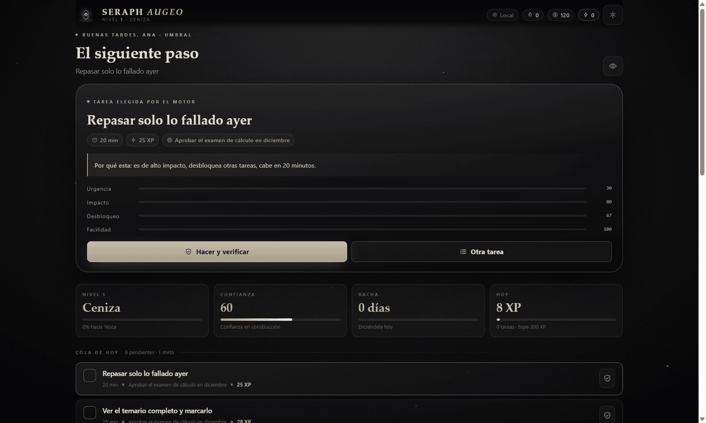

# Seraph Augeo v3 · El ojo que recuerda lo que hiciste

Sistema de metas que **verifica lo que realmente ocurrió**, no lo que prometes.
Cada tarea completada se somete a una verificación transparente (evidencia,
detalle, tiempo e historial) que decide cuánta experiencia otorga; el progreso se
convierte en niveles, rachas, cofres y artefactos. Un **serafín en 3D** preside el
menú: desciende del cielo, aterriza con una onda de luz y, al pulsar **Entrar**,
la cámara se zambulle en su halo.

Antes de entrar hay una **puerta de la Inteligencia**: eliges un proveedor de IA
(31 opciones, en la nube o local), la app hace una llamada real y **sólo te deja
pasar si esa llamada responde**. Basta con que un proveedor funcione.

**Sin servidor de ningún tipo.** Ni backend, ni base de datos, ni proceso que
mantener encendido: la aplicación compilada es un solo archivo HTML que se abre
con doble clic. El progreso y las claves de IA viven en el almacenamiento local
del navegador.



*La pantalla de **Hoy**: el motor elige la siguiente tarea, explica por qué y muestra los factores con los que la puntuó.*

---

## Descargas

Escritorio y móvil: [**v3.3.0**](../../releases/tag/v3.3.0)

| Sistema | Archivo |
|---|---|
| **Windows** (x64) | `SeraphAugeo-3.3.0-portable.exe` — portable, no se instala |
| **macOS** Apple Silicon (M1–M4) | `SeraphAugeo-3.3.0-mac-arm64.tar.gz` |
| **macOS** Intel | `SeraphAugeo-3.3.0-mac-x64.tar.gz` |
| **Linux** (x64) | `SeraphAugeo-3.3.0-linux-x64.tar.gz` |
| **Android** (7.0 o superior) | `SeraphAugeo-3.3.0-android.apk` — se instala desde la Release |

**Nuevo en 3.3.0:** base de datos opcional para el progreso. En **Ajustes →
Cuenta y base de datos** puedes conectar un proyecto Postgres (Supabase) y seguir
el mismo progreso en el móvil, el PC y la web. Sin conectarlo, todo se guarda en
el dispositivo como siempre. Los pasos están en la
[sección 10 del README de la app](seraph-augeo-v3-completo/seraph-augeo-v3/README.md#10-base-de-datos-y-sincronización-opcional).

En iPhone y iPad no hay `.ipa`: compilarlo exige macOS con Xcode. Mientras
tanto la app se añade a la pantalla de inicio desde **Safari → Compartir →
Añadir a pantalla de inicio**, y arranca a pantalla completa con su icono.

Integridad: cada archivo tiene su SHA-256 en el `SHA256SUMS.txt` de su Release; descárgalo junto al binario y comprueba con `sha256sum -c SHA256SUMS.txt` (Windows/Linux) o `shasum -a 256 -c SHA256SUMS.txt` (macOS).

Los binarios no están firmados: Windows SmartScreen pedirá *Más información →
Ejecutar de todas formas*, y en macOS puede hacer falta clic derecho → Abrir. En
Linux, si el sandbox de Chromium se queja, añade `--no-sandbox`. En Android, el
APK se firma con una clave de sideload, así que hay que permitir «Instalar apps
desconocidas» al abrirlo; no está en Google Play.

También puedes abrir directamente el HTML sin instalar nada, o compilarlo tú
mismo (ver más abajo).

---

## Contenido del repositorio

| Ruta | Qué es |
|---|---|
| `seraph-augeo-v3-completo/seraph-augeo-v3/` | **La aplicación.** Código fuente, compilación, pruebas, documentación y empaquetado de escritorio y móvil |
| `SKILLS.md` | Especificación funcional original: propósito, alcance del MVP y contexto del producto |
| `prueba-demo/` | Carpeta de pruebas suelta, sin relación con la app |
| `.gitignore` | Excluye dependencias, binarios de Electron, secretos y paquetes generados |

## Estructura del proyecto

```
seraph-augeo-v3/
├── index.html                  Punto de entrada en desarrollo
├── build.mjs                   Empaqueta todo en un HTML autocontenido
├── seraph-augeo-v3.html        Entrega compilada (~4,1 MB, 22 módulos incrustados)
├── manifest.webmanifest         Metadatos de aplicación web
├── LEEME.txt                    Resumen rápido en texto plano
├── assets/
│   ├── engine.js               Núcleo determinista: fases, niveles, verificación,
│   │                           15 rarezas, botín, 20 artefactos, misiones, racha
│   ├── sigil.js                El sello: ojo vertical, seis alas y halo (SVG animado)
│   ├── styles.css              Sistema visual y atmósferas de cada fase
│   ├── manifest.js             Lista ordenada de módulos (único sitio a tocar al añadir uno)
│   ├── boot.js                 Cargador: inyecta los módulos y arranca el núcleo
│   ├── actions.js              Acciones, ajustes, exportar/importar, reinicio
│   ├── guardian.js             Ángel Guardián: preguntas, veredicto, respaldo local
│   ├── main.js                 Arranque, estado inicial y API para las pruebas
│   ├── ai/
│   │   ├── client.js           Motor de IA: 31 proveedores, perfiles, sondeo real
│   │   └── setup.js            Puerta de la Inteligencia: pantalla y modal
│   ├── core/                   DOM, estado en localStorage, economía
│   ├── data/                   Áreas y plantillas de planes
│   ├── ui/                     Intro cinematográfica y armazón de la interfaz
│   ├── views/                  Hoy, Metas, Cofres, Guardián, Altar, Onboarding
│   ├── modals/                 Verificación de tareas
│   └── intro/                  Serafín en WebGL y su modelo `angel.glb` (2,1 MB)
├── desktop/                    Envoltorio Electron (Windows, macOS, Linux)
│   ├── main.js                 Ventana, IPC y peticiones HTTP sin CORS
│   ├── preload.js              Puente aislado hacia la página
│   ├── pack-platforms.sh       Monta los paquetes de macOS y Linux
│   └── pack-tar.py             Comprime con permisos y enlaces simbólicos correctos
├── mobile/                     Envoltorio Android (WebView) y compilación del APK
│   ├── android/                Manifiesto, actividad Java, iconos y tema
│   ├── build-android.sh        aapt2 + javac + d8 + zipalign + apksigner
│   └── LEEME.md                Cómo compilar el APK y por qué iOS no está aquí
├── tests/                      Motor, cliente de IA, humo de interfaz y arranque file://
├── tools/                      Preparación del GLB y visor 3D
└── docs/                       Manuales técnico, de usuario y de despliegue
```

## Requisitos

- **Para usar la app:** ninguno. Sólo un navegador moderno, o el paquete de
  escritorio de tu sistema.
- **Para compilar y probar:** [Node.js](https://nodejs.org) 18 o superior y
  `bash` (Git Bash en Windows).

## Ejecutar

### Navegador, sin instalar nada

Abre `seraph-augeo-v3-completo/seraph-augeo-v3/seraph-augeo-v3.html` con doble
clic. Motor, verificación, cofres, serafín e IA viven dentro del archivo.

Si un navegador muy restrictivo bloquea las peticiones desde `file://`, sirve la
carpeta por HTTP estático (sigue sin haber servidor propio) o usa la versión de
escritorio, donde no hay CORS.

### Escritorio

```bash
cd seraph-augeo-v3-completo/seraph-augeo-v3/desktop
npm install
npm start
```

La versión de escritorio envía las peticiones de IA desde el proceso principal,
así que funcionan todos los proveedores, también los locales (Ollama, LM Studio,
llama.cpp…).

## Compilar

### El archivo HTML único

```bash
cd seraph-augeo-v3-completo/seraph-augeo-v3
npm install
node build.mjs        # genera seraph-augeo-v3.html (~4,1 MB, 22 módulos)
```

`build.mjs` lee `assets/manifest.js`, así que un módulo nuevo se empaqueta solo
con declararlo ahí. El HTML resultante no hace ni un `fetch`: funciona con
`file://` y sin conexión.

### Los paquetes de escritorio

```bash
cd seraph-augeo-v3-completo/seraph-augeo-v3/desktop
npm install
npm run dist:win          # Windows: .exe portable
npm run dist:win-installer  # Windows: instalador NSIS
bash pack-platforms.sh    # Linux x64 + macOS arm64 + macOS Intel (reanudable)
```

`pack-platforms.sh` no depende de `electron-packager`: descarga el Electron de
cada plataforma en `desktop/vendor/` (con reanudación, útil con conexiones lentas)
y monta los paquetes en `desktop/dist/`. Los detalles —firma en macOS, permisos
de `chrome-sandbox` en Linux, compresión con `pack-tar.py`, avisos de
SmartScreen— están en [`docs/MANUAL-DE-DESPLIEGUE.md`](seraph-augeo-v3-completo/seraph-augeo-v3/docs/MANUAL-DE-DESPLIEGUE.md).

### El APK de Android

```bash
cd seraph-augeo-v3-completo/seraph-augeo-v3
node build.mjs                  # el APK empaqueta este HTML
bash mobile/build-android.sh    # deja mobile/dist/SeraphAugeo-<versión>-android.apk
```

`build-android.sh` no usa Gradle: encadena `aapt2`, `javac`, `d8`, `zipalign` y
`apksigner` del SDK de Android. Necesita un JDK 17 o superior y `build-tools`
con `platforms/android-36`. Los detalles están en
[`mobile/LEEME.md`](seraph-augeo-v3-completo/seraph-augeo-v3/mobile/LEEME.md).

Los binarios **no se versionan** (están en `.gitignore`): se regeneran con los
comandos de arriba y se adjuntan a una *Release* de GitHub, como la de
[v3.3.0](../../releases/tag/v3.3.0), que reúne escritorio y Android.

## Pruebas

```bash
cd seraph-augeo-v3-completo/seraph-augeo-v3
npm install
npm test                  # ejecuta las tres suites y termina con «Todo en verde»
```

| Suite | Qué cubre |
|---|---|
| `tests/engine.test.js` | 79 pruebas: fórmulas, rarezas, botín, misiones, racha |
| `tests/client.test.js` | 19 pruebas: clave, proveedor, CORS, timeout, cuota, caché, JSON |
| `tests/smoke.test.js` | 28 pruebas: intro, onboarding, puerta de IA, verificación, cofre, pestañas |
| `tests/file-boot.js` | Arranque desde `file://`, sin servidor |

`smoke.test.js` necesita `jsdom`; la app en sí **no tiene dependencias**.

## La puerta de la Inteligencia

```
Elegir proveedor → URL / modelo / clave → «Probar conexión»
      → llamada real → {"ok":true} → perfil listo → «Continuar» habilitado
```

- Guardar una clave **no** abre la puerta. Sólo la abre una respuesta real.
- Si falla, la app dice qué pasó: sin conexión, clave inválida, modelo
  inexistente, URL inválida o error del proveedor.
- Puedes guardar varios perfiles y cambiar de activo cuando quieras.
- Sin ningún proveedor validado, **Continuar** permanece deshabilitado.

**Nube (22):** OpenAI · Anthropic · Gemini · OpenRouter · Groq · Mistral ·
DeepSeek · xAI · Together AI · Fireworks · Perplexity · Cerebras · DeepInfra ·
Hyperbolic · Nebius · SambaNova · Novita · GitHub Models · Moonshot · Z.ai ·
Alibaba (Qwen) · SiliconFlow.

**Local (8):** Ollama · LM Studio · llama.cpp · vLLM · Jan · GPT4All · KoboldCpp ·
text-generation-webui. **Comodín:** «Otro», para cualquier API compatible con
OpenAI.

IA local en cuatro pasos: instala Ollama, `ollama pull llama3.1:8b`, comprueba
`http://localhost:11434` y en la puerta elige Ollama con
`http://localhost:11434/v1`. Si dejas el modelo vacío, la app consulta
`GET /v1/models` y elige el primero disponible.

## Seguridad y privacidad

- Las claves de IA viven **sólo** en `localStorage` del equipo y viajan
  únicamente al proveedor elegido. No hay servidor de la app que las reciba.
- Cualquiera con acceso al perfil del navegador puede leerlas: usa claves con
  tope de gasto y ámbito restringido.
- En escritorio: `contextIsolation` activo, sin Node en la página, navegación
  externa derivada al navegador del sistema y peticiones limitadas a 4 MB.
- Progreso en `localStorage`, exportable e importable en JSON. Sin cuentas, sin
  correo, sin analítica, sin publicidad.

## Documentación

| Documento | Para qué |
|---|---|
| [`docs/MANUAL-TECNICO.md`](seraph-augeo-v3-completo/seraph-augeo-v3/docs/MANUAL-TECNICO.md) | Arquitectura, motor de IA, puerta, build, pruebas, riesgos |
| [`docs/MANUAL-DE-USUARIO.md`](seraph-augeo-v3-completo/seraph-augeo-v3/docs/MANUAL-DE-USUARIO.md) | Uso diario, configurar IA, verificación, problemas frecuentes |
| [`docs/MANUAL-DE-DESPLIEGUE.md`](seraph-augeo-v3-completo/seraph-augeo-v3/docs/MANUAL-DE-DESPLIEGUE.md) | Compilar `.exe` / macOS / Linux, firmar, publicar |
| [`SKILLS.md`](SKILLS.md) | Especificación funcional del producto |

## Límites declarados

- La verificación es una **heurística** transparente: evidencia, detalle, tiempo
  e historial. No lee tu mente.
- La IA puede caerse (503 de Gemini, 429 en planes gratuitos). Por eso el motor
  local es de primera clase y la app lo dice en pantalla.
- Sin sincronización entre dispositivos: el progreso vive en un equipo.
- Los binarios no están firmados: macOS pedirá clic derecho → Abrir y Windows
  SmartScreen advertirá.

## Licencia

MIT.
